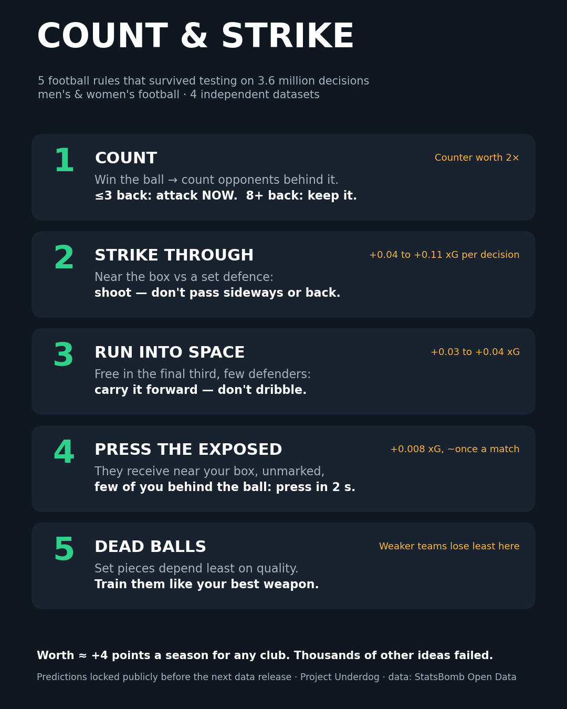

# Count & Strike

**A football playing system built only from tactical advantages that held up on data they had never seen.**



> Don't try to pass your way through a settled defence. Count the defenders: if they're not set, strike now. If they're set and you're near goal, strike through them.

## The five rules

| Rule | When | Do | Evidence |
|---|---|---|---|
| **Count** | You win the ball | ≤3 opponents behind it: attack now. 8+: keep it | each extra defender back −11–19% counter value; confirmed in 3 populations, plus 4 event-data populations |
| **Strike through** | Near the box against a set defence | Shoot rather than pass sideways or back | +0.04 to +0.11 xG per decision; holds with the shooting lane held equal, and 60 s later |
| **Run into space** | Free in the final third, few defenders | Carry forward, don't dribble | +0.03–0.04 xG |
| **Press the exposed** | They receive near your box, unmarked, few of you goal-side | Press within 2 s | +0.008 xG |
| **Dead balls** | Set pieces | Treat them as a main weapon | quality matters 1/3–2/3 as much as in open play, in 4 populations |

Worth roughly **+4 points a season** for any club (simulated 2025/26 Premier League).

## How it was found

* **Search:** 3.6 million on-ball decisions (StatsBomb event + 360 data, Wyscout), split into ~3,400 situations, ~8,700 candidate rules.
* **Filter:** false-discovery control on the discovery data (men's international tournaments). Then confirmation required in **both** unseen populations (men's club, women's).
* **Stress tests:** same space, same shooting lane, longer horizon, team-quality controls.
* **Pre-registration:** 16 rounds, each written to git before its analysis ran (`PREREGISTRATION*.md`). Every deviation is in `DEVIATIONS.md`, and the full research log is in `PROGRESS.md`.

Most ideas died, including chasing earlier, long throws, corner targets, opponent weak spots, passing tempo, referee adaptation, and simulator-optimised policies. That is documented too.

## Locked predictions

[`PREDICTIONS.md`](PREDICTIONS.md) holds six numeric predictions, committed **14 October 2026**, for the next StatsBomb 360 release. Anyone can test them:

```bash
python3 src/test_predictions.py <competition_id> <season_id>
```

## Papers

* [`paper/count_and_strike.pdf`](paper/count_and_strike.pdf): the system (5 pages)
* [`paper/underdog_paper.pdf`](paper/underdog_paper.pdf): full technical report (rounds 1–10)

## Match planner

`python3 src/matchplan.py "<us>" "<home>" "<away>" <div> <oddsH> <oddsD> <oddsA>` writes a one-page plan for a fixture. A web version is in `site/count-and-strike.html`.

## Data

StatsBomb Open Data (including 360), used under the StatsBomb public data user agreement, with attribution. Pappalardo et al. (2019) Wyscout public dataset. football-data.co.uk. Raw data is downloaded by the scripts in `src/` and is not committed.
