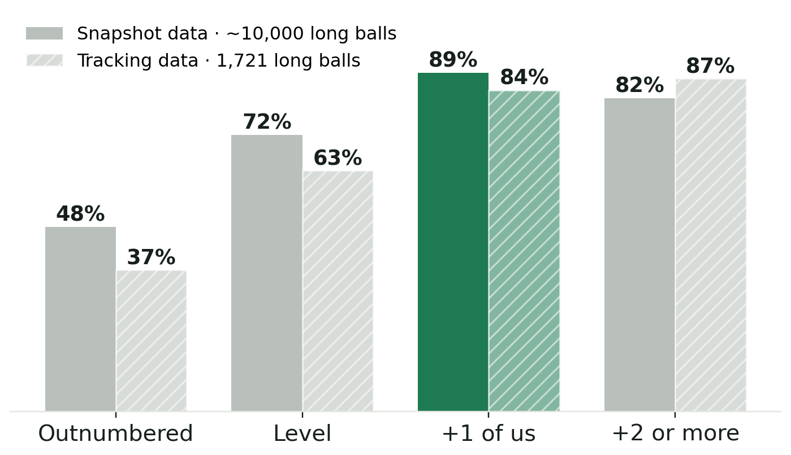

# Football Beliefs, Tested

**We tested about 9,400 football ideas on 3.6 million real decisions and 30 tracked matches. Most failed. A few held up.**

📄 **Read the paper:** [`paper/Football_Beliefs_Tested.pdf`](paper/Football_Beliefs_Tested.pdf) (8 pages)

> **Correction (October 2026).** Version 1 of this project ("Count & Strike") overclaimed. Its headline rule, *Strike through* (shoot rather than recycle near the box), plus *Run into space*, *Press the exposed* and the "+4–8 points a season" estimate, did **not** survive stricter tests added in round 22. Those tests check whether the moment *before* a decision was already better. Shots, for example, happen when the moment is already good. The current findings are below, and the full history is kept in this repository.

## What holds up

| Finding | Evidence |
|---|---|
| **Going long? Have one more player than them where it lands.** | Ball kept 84–89% of the time vs 63–72% when level and 37–48% when outnumbered. A second extra player adds nothing. Shown in StatsBomb 360 (3 populations, stress-tested) **and** in tracking data (Bundesliga, A-League). |
| **Set pieces are the underdog's equaliser** | Team quality drives set-piece chances only ⅓–⅔ as much as open play, in 3 datasets |
| **Baiting one side shifts the block** (mechanism) | The far side opens (+1.3 m in tracking data); the switch itself showed no extra chances |
| **Passing into the lane with more of your players** (small) | Completed 2–4 points more often; no extra chances |
| **Counters are worth ~2× with ≤3 opponents behind the ball** (a reading, not a rule) | Confirmed in 3 populations; "go fast" isn't proven better than keeping it |



## What failed (selection)

"Most vulnerable after scoring", pressing triggers, pressing more, quick restarts, attacking the opponent's "weak side", formation matchups, early subs, chasing earlier, extra runners on the counter, "go forward more", "pass faster", "only cross with bodies in the box", "shoot more", underdog-only tactics (369 tests: none) and simulator-designed tactics (all exploits). Details are in the paper and `PROGRESS.md`.

## How it was tested

* Discovery in men's international tournaments, then confirmation required in **both** men's club and women's football.
* Like-for-like comparisons (zone, pressure, defenders around the player), doubly robust re-estimation, and a "moment before" placebo.
* Every test was pre-registered in git before it ran (`PREREGISTRATION*.md`). Deviations are in `DEVIATIONS.md`, and the full log is in `PROGRESS.md`.
* [`PREDICTIONS.md`](PREDICTIONS.md) holds numeric predictions locked before the next StatsBomb 360 release (`python3 src/test_predictions.py <competition_id> <season_id>`).

## Data

StatsBomb Open Data (including 360), used under the StatsBomb public data user agreement, with attribution. Pappalardo et al. (2019) Wyscout public dataset. Metrica Sports sample data, SkillCorner open data, and DFL/IDSSE open tracking data (Bassek et al. 2025). football-data.co.uk. Raw data is downloaded by the scripts in `src/` and is not committed.

---

## History

### v1 (14 October 2026), superseded

**A football playing system built only from tactical advantages that held up on data they had never seen.**


> Don't try to pass your way through a settled defence. Count the defenders: if they're not set, strike now. If they're set and you're near goal, strike through them.

#### The five rules (v1)

| Rule | When | Do | Evidence |
|---|---|---|---|
| **Count** | You win the ball | ≤3 opponents behind it: attack now. 8+: keep it | each extra defender back −11–19% counter value; confirmed in 3 populations, plus 4 event-data populations |
| **Strike through** | Near the box against a set defence | Shoot rather than pass sideways or back | +0.04 to +0.11 xG per decision; holds with the shooting lane held equal, and 60 s later |
| **Run into space** | Free in the final third, few defenders | Carry forward, don't dribble | +0.03–0.04 xG |
| **Press the exposed** | They receive near your box, unmarked, few of you goal-side | Press within 2 s | +0.008 xG |
| **Dead balls** | Set pieces | Treat them as a main weapon | quality matters 1/3–2/3 as much as in open play, in 4 populations |

Worth roughly **+4 points a season** for any club (simulated 2025/26 Premier League).

#### How v1 was found

* **Search:** 3.6 million on-ball decisions (StatsBomb event + 360 data, Wyscout), split into ~3,400 situations, ~8,700 candidate rules.
* **Filter:** false-discovery control on the discovery data (men's international tournaments). Then confirmation required in **both** unseen populations (men's club, women's).
* **Stress tests:** same space, same shooting lane, longer horizon, team-quality controls.
* **Pre-registration:** 16 rounds, each written to git before its analysis ran (`PREREGISTRATION*.md`). Every deviation is in `DEVIATIONS.md`, and the full research log is in `PROGRESS.md`.

Most ideas died, including chasing earlier, long throws, corner targets, opponent weak spots, passing tempo, referee adaptation, and simulator-optimised policies. That is documented too.

#### Locked predictions (v1)

[`PREDICTIONS.md`](PREDICTIONS.md) holds six numeric predictions, committed **14 October 2026**, for the next StatsBomb 360 release. Anyone can test them:

```bash
python3 src/test_predictions.py <competition_id> <season_id>
```

#### v1 papers

* [`paper/count_and_strike.pdf`](paper/count_and_strike.pdf): the system (5 pages)
* [`paper/underdog_paper.pdf`](paper/underdog_paper.pdf): full technical report (rounds 1–10)

#### Match planner

`python3 src/matchplan.py "<us>" "<home>" "<away>" <div> <oddsH> <oddsD> <oddsA>` writes a one-page plan for a fixture. A web version is in `site/count-and-strike.html`.

#### Data (v1)

StatsBomb Open Data (including 360), used under the StatsBomb public data user agreement, with attribution. Pappalardo et al. (2019) Wyscout public dataset. football-data.co.uk. Raw data is downloaded by the scripts in `src/` and is not committed.
