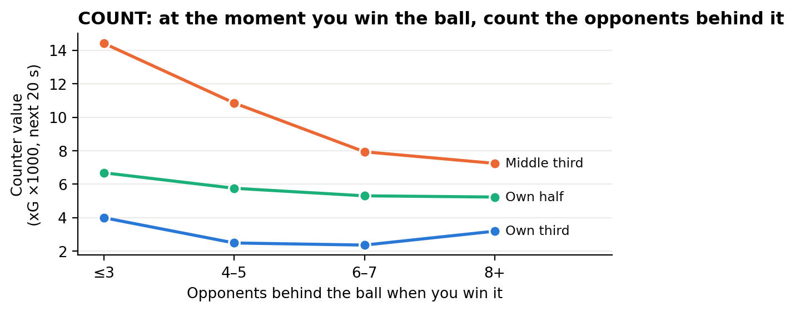
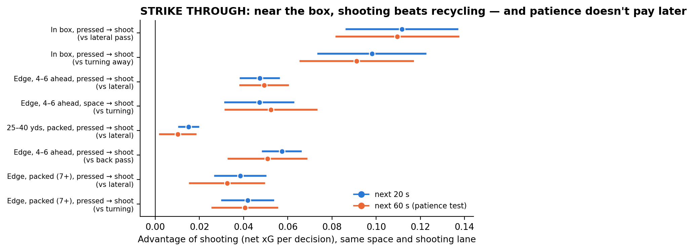

# Count & Strike

### A football playing system built only from advantages that survived out-of-sample tests

*Project Underdog, October 2026. Code, data pipeline, 15 pre-registrations and every result: `underdog/` (branch `project-underdog`). Full technical report: `underdog_paper.pdf`.*

---

## The idea in one paragraph

Football's great systems (Total Football, *gegenpressing*, *juego de posición*) were invented by coaches and then proven on the pitch. We went the other way. We let a search engine compare **every on-ball choice in 3.6 million decisions**, then kept only advantages that reappeared in football the search had never seen: different competitions, men's and women's, two data providers. **Thousands of patterns were found. Most were illusions**: they described good *moments*, not good *choices*. What survived is small, specific and consistent, and it adds up to one principle:

> **Don't try to pass your way through a settled defence. Count the defenders: if they are not set, strike now; if they are set and you are near goal, strike through them.**

## How the rules were found (and filtered)

| Step | What | Scale |
|---|---|---|
| 1 | Every pass, carry, dribble and shot, with what happened in the next 20 s (our xG − their xG) | 2.9M decisions (event data) + 0.73M with "what the player saw" (360 frames) |
| 2 | Split into situations: zone, defenders ahead, nearest opponent, teammates ahead, score, minute | ~3,400 situations |
| 3 | Compare every option against the usual option in each situation | ~8,700 candidate rules |
| 4 | Keep rules that pass a false-discovery filter in the **discovery** data (men's international tournaments) | 22 |
| 5 | Keep only rules that hold, with the same sign, in **both** unseen populations (men's club football; women's football) | **12** |
| 6 | Stress tests on the shooting rules: same shooting lane, 60-second horizon | 7 of 8 hold fully, 1 weakens |

What died along the way is listed in the technical report, and it is most of football analytics' folklore. Examples: "teams should chase earlier", "long throws are undervalued", "aim corners at the penalty spot", "fast-passing teams create more" (that one was just good teams), "find the opponent's weak spot", and "AI-optimised in-game style switching".

## The system: five principles

### 1. COUNT: when you win the ball, count the opponents behind it

Each extra opponent behind the ball at the moment you win it cuts your counter-attack's value by **11–19%**. This was confirmed separately in all three 360 populations (p < 0.05 in each). In the middle third, a regain with ≤3 opponents back is worth **2×** one with 8+ back. Event data from four further populations show the same thing from the other side: when the opponent had just pushed into your box, your counter is worth **1.4–1.7×**.

**Rule:** ≤3 behind the ball → **go now** (two runners, first pass forward). 8+ behind → **keep it**.

### 2. STRIKE THROUGH: near the box, shoot rather than recycle

When the defence *is* set, recycling the ball rarely breaks it. In the situations below, shooting beat the alternative in all three populations. That held with the number of defenders in the shooting lane held equal, and players had actually shot *into more crowded lanes* than they passed into. It also still held 60 seconds later, so patience does not pay off later.

| Situation | Shoot instead of | Advantage per decision |
|---|---|---|
| In the box, central, ≤3 ahead, even when pressed | laying it off / turning away | **+0.09 to +0.11 xG** |
| Edge of the box, central, 4–6 ahead | lateral / back pass / turning | **+0.05** |
| Edge of the box, central, packed (7+ ahead), pressed | lateral / turning | **+0.03 to +0.04** |
| 25–40 yds, central, packed, pressed | lateral pass | +0.010 to +0.015 *(weaker: positive overall, not in every population at 60 s)* |

Teams currently recycle in these spots **far more often than they shoot**, about 7 to 1 from long range. This runs against a decade of "stop taking low-xG shots" analytics. A shot is low value, but the pass back in front of a settled block is worth even less.

### 3. RUN INTO SPACE

Attacking third, no one within 7 yards, ≤3 defenders ahead: **carry the ball forward** instead of dribbling at a man or turning back (**+0.04 xG** per decision, confirmed ×3).

### 4. PRESS THE EXPOSED RECEIVER

When an opponent receives near your box, unmarked, with medium support and only ≤5 of your players goal-side: **press within 2 seconds rather than hold shape** (+0.008 net xG per decision, about once a match; confirmed in both unseen populations). This is the only pressing rule out of 102 tested that survived. Blanket pressing rules did not.

### 5. DEAD BALLS ARE THE EQUALISER

Set-piece chances depend on team quality only a third to two-thirds as much as open-play chances do. That held in four populations (StatsBomb 2015/16, Wyscout 2017/18, unseen women's/ISL leagues). It is the one channel where a cheaper squad loses the least ground.

*(Plus one model-based layer, not data-confirmed: score/minute tempo management. Protect a level score as the weaker team and open up late; the exact switching minute depends on the opponent.)*

## What it is worth

Following the confirmed in-game rules half the time is worth about **+3.6 to 4 xG a season**. Together with set-piece excellence and match management, the simulator puts the whole system at **about +4 points a season**, for any club:

| Club (2025/26 strength) | Without → with Count & Strike |
|---|---|
| Man City | title 38% → **54%** |
| Chelsea | top four 45% → **64%** |
| Newcastle | top four 21% → **37%** |
| Leeds | relegation 13% → **6%** |
| Sunderland | relegation 40% → **23%** |
| Wolves | relegation 75% → 58% |

*(The 4 points includes one assumption we label in the report: the "break" rule's in-game uplift.)*

## What it is not

* **Not a miracle.** No rule we found turns a mid-table squad into a champion. The value is a few points: enough to survive, qualify or win a close title race.
* **Not causal proof.** These are observational comparisons. They are made as fair as public data allows (same situation, same space, same shooting lane, three populations), but players' choices still reflect things we cannot see. The final proof is a trial. Football's statistics make that feasible only with fast measures: one club, one or two seasons (protocol in the technical report).
* **Not secret for long.** If everyone adopts it, the edge goes to whoever adopts it first and best.

## What simulation adds, and where it misleads

We built a possession simulator, a "chess engine" for football. It learns from 730k decisions how each choice changes the next situation (keep the ball, lose it, shoot), then searches for better choices using only moves teams actually make. Its advice was checked on models learned separately from men's club and women's football.

* **Direction: confirmed.** In both populations, every improvement it found is the same kind: near goal, shoot, carry forward or cross instead of passing back or sideways. That is Count & Strike's "strike through" principle. Two new candidate plays came from it: **cross high from the edge of the box instead of passing back against a set defence** (+0.03 xG), and **dribble rather than pass sideways when pressed in the box** (+0.02). Both are unproven.
* **Size: not credible.** Taken literally, the simulator's full policy is worth ~100 xG a season, an impossible 3–4× overstatement. The reason is that it only "sees" forward options in moments when they existed. Cross-checking on other leagues cannot remove this, because the bias is the same everywhere. **Simulation-based "AI tactics engines" built on match data overclaim**, and this one did too.

## Locked predictions

We cannot run a club trial. So we locked six numeric predictions in public (`PREDICTIONS.md`, git commit `dc37f05`, 14 October 2026) for the **next StatsBomb release with 360 data** (e.g. World Cup 2026), which was never used to build the rules. Count & Strike counts as supported if ≥5 of 6 hold. A dry run shows one 51-match tournament has enough data for the test. Anyone can run it with `python3 src/test_predictions.py <competition> <season>`.

## Use it tomorrow

`src/matchplan.py` turns any fixture plus its odds into a one-page plan. The plan gives win/draw/loss chances, the score-and-minute tempo grid, the set-piece emphasis for this opponent, the opponent's persistent habits, and the **Count & Strike rule card** for the dressing room.

---

*Data: StatsBomb Open Data incl. 360 (with thanks); Pappalardo et al. (2019) Wyscout public dataset; football-data.co.uk. Everything pre-registered in git before analysis; deviations logged.*
