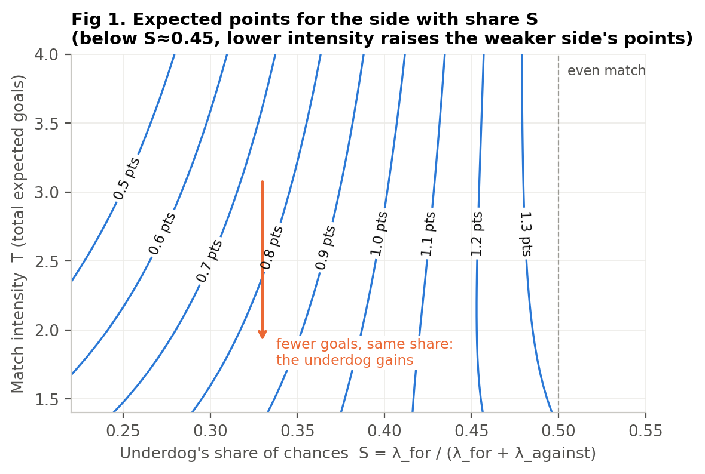
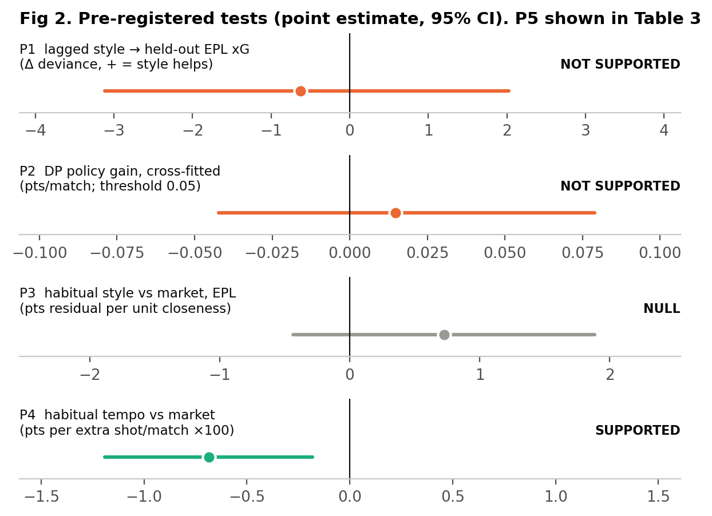
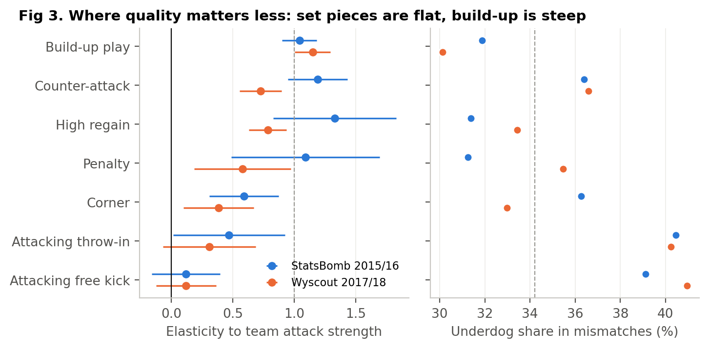
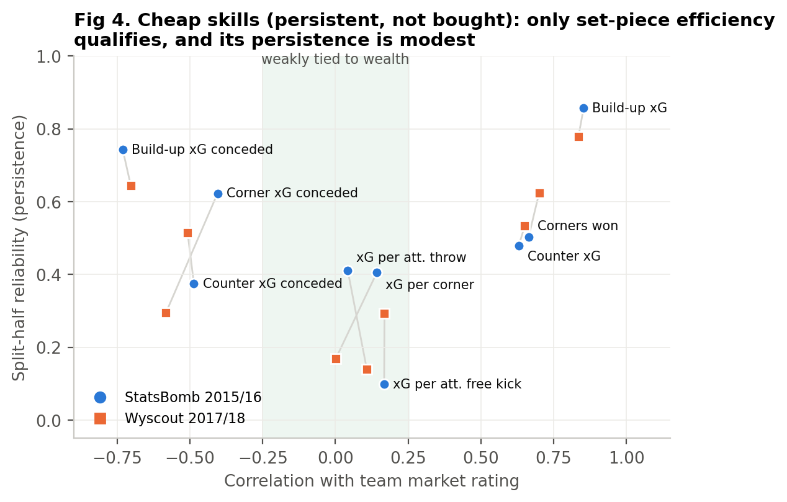
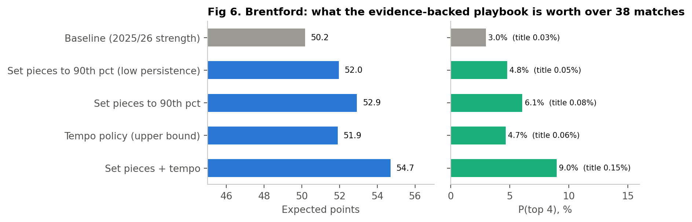
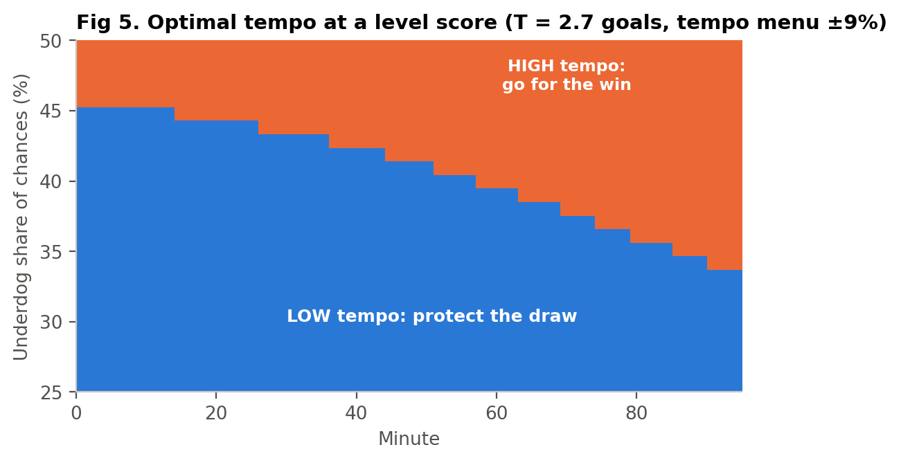
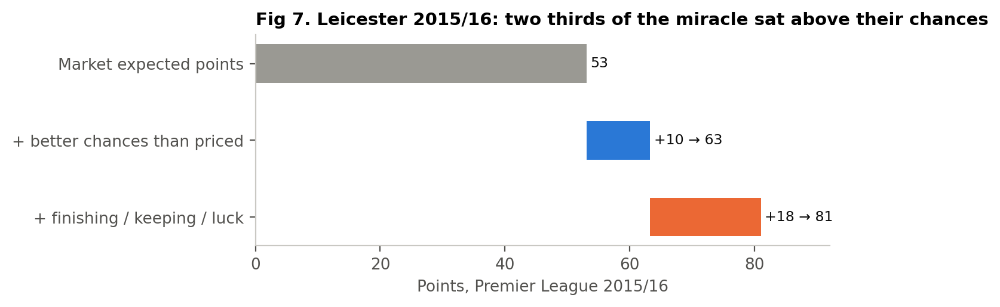
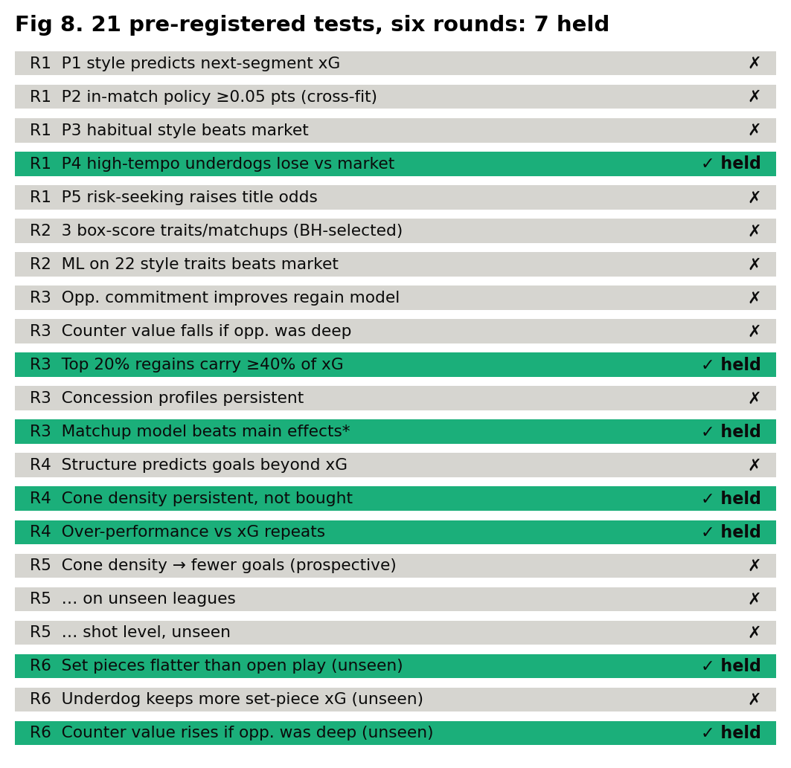
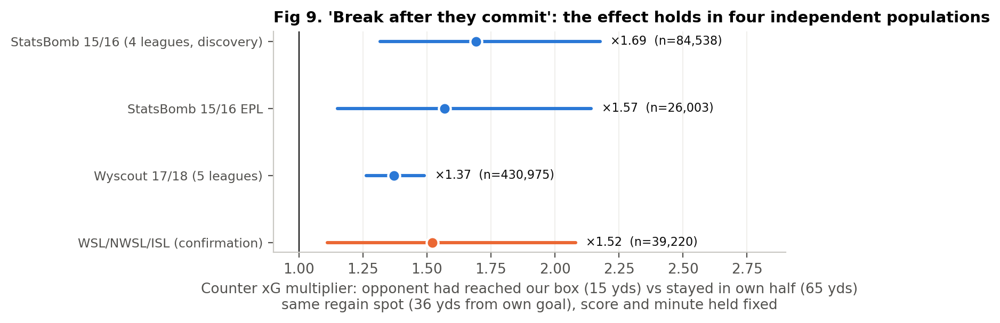

# Project Underdog: Can Tactics Make Quality Matter Less?

### Six pre-registered rounds, 21 tests, two confirmed tactical patterns

*Autonomous research run, 11–12 October 2026. Every round was pre-registered in git before its data were analysed (`PREREGISTRATION*.md`, commits `d94684e`, `56a3532` and later). Deviations are logged in `DEVIATIONS.md`.*

---

## Abstract

We asked whether a weaker football team can systematically change the *structure* of a match so that player quality matters less, and what that would be worth to a club like Brentford. Over six pre-registered rounds we tested 21 hypotheses. The data were event data for 3,954 matches across four independent populations (StatsBomb big-five 2015/16, Wyscout big-five 2017/18, and unseen StatsBomb WSL/NWSL/ISL seasons), plus closing odds for 45,825 matches. Every candidate had to survive an out-of-sample, out-of-time or out-of-population test whose direction was fixed in advance.

**Most ideas died.**
* In-match style knobs and coaching changes did not move chance rates beyond what score and minute already explain.
* An optimised in-match policy gained nothing once scored on data it was not tuned on.
* No style trait or style matchup built from box-score data (shots, fouls, corners, cards) beat the betting market after 2017. That includes a machine-learning search over 22 traits.
* Opponents' channel-specific "weak spots" did not predict anything.
* A promising defensive-structure trait ("cone density") failed all three confirmation tests.

**Two tactical patterns survived confirmation on unseen leagues.**
1. **Set pieces are where quality matters least.** Set-piece xG is far less sensitive to team strength than open-play xG. The elasticity was 0.41 vs 1.09 (StatsBomb), 0.28 vs 0.89 (Wyscout), and 0.72 vs 1.02 on unseen leagues (difference CI [0.11, 0.50]).
2. **"Break after they commit."** At the same regain spot, score and minute, a regain made after the opponent had pushed into our box yields **1.4–1.7× more counter-attack xG** than one made while they were still in their own half. All four populations agree: ×1.69, ×1.57, ×1.37, ×1.52, every 95% CI above 1.

Round 1 also found a modest, fading market effect: high-tempo underdogs underperform the closing market, by 0.007 points per habitual shot.

What tactics are worth is bounded. For Brentford at 2025/26 strength, every evidence-backed lever together is worth **+1.8 to +4.5 points a season**: top-four odds rise from 3% to 5–9%, and title odds stay at or below 0.15%. The project's answer: there *are* structures in which quality matters less, and repeatable moments when a stronger team is vulnerable. They are worth a few points a season, not a title.

---

## 1. The question

The brief was to treat football as a sequential decision problem and look for a tactical policy, not a prediction model, that lets a weaker squad consistently outperform stronger ones. "Rediscovering" set pieces and direct play would not count; the goal was something materially better, with credible counterfactual validation.

Two traps were clear from the start, and the design is built around them.

1. **Historical data show what teams did, not what would have happened otherwise.** Style and outcomes are entangled. When the opponent attacks, our defensive actions are deep *because* they are attacking.
2. **An optimiser will exploit its own simulator.** A policy tuned on a fitted model always looks good when it is scored on the same model.

So we pre-registered the hypotheses, kept the 2015/16 Premier League out of model fitting, and evaluated every optimised policy on a fit it had not seen.

## 2. Data

| Source | Coverage | Used for |
|---|---|---|
| StatsBomb Open Data | 1,551 matches, 2015/16: full EPL, La Liga, Serie A, Ligue 1, plus 34 Bundesliga. 5.4M events with xG | style, segments, coaching decisions, chance channels |
| Wyscout public dataset (Pappalardo et al., 2019) | 1,826 matches, 2017/18, big five | out-of-season, out-of-provider replication |
| StatsBomb Open Data (unseen) | 577 matches: WSL 2018/19–2020/21, NWSL 2023, ISL 2021/22 | confirmation only (rounds 5–6) |
| football-data.co.uk | 45,825 big-five matches 2000/01–2025/26, closing odds + shots | market strength, P4, 2025/26 season simulation |

**Market strength.** For every match we de-vig the closing 1X2 odds (Pinnacle closing where available) and invert them, together with the over/under 2.5 price when available, into Poisson goal rates (λ_home, λ_away) with a Dixon–Coles correction. This is the strength baseline throughout. It is demanding: anything the market already knows is not an edge.

**Segments.** Each match is cut into stretches of constant game state. Cuts fall at 15-minute marks, every goal and every red card, giving 27,570 team-segments. For each one we record xG for and against, and four style descriptors: defensive-action height, pressures per opponent pass, long-pass share and pass share.

## 3. Framework: the underdog's exchange rate

Write a team's chance production as λ_for and λ_against. Any tactic moves the match along two axes: **intensity** T = λ_for + λ_against, and **share** S = λ_for / T. Figure 1 shows expected points for the side with share S. Below S ≈ 0.45 the iso-point lines tilt, so at a fixed share **fewer total goals raise the weaker side's points.** More draws, and more noise relative to quality.

The exchange rate is concrete. For a 30%-share underdog in a 2.7-goal match, cutting total intensity by one goal is worth +0.10 points/match, the same as gaining 3.4 percentage points of share. For a 40%-share side the same cut is worth only +0.045. This is the theoretical case for "shrinking the game". The empirical question is whether any lever moves T without giving back more than that in S.

The in-match decision problem is solved exactly. The state is (minute, goal difference), the actions are style modes with per-minute scoring rates, and the terminal utility is league points (3/1/0) or any other utility. Backward induction gives the optimal policy, and a forward pass gives the outcome distribution (`src/dp.py`).

## 4. Pre-registered results

| | Hypothesis (registered direction) | Result | Verdict |
|---|---|---|---|
| **P1** | Lagged style improves held-out EPL xG prediction | Δdev −0.62, CI [−3.12, +2.02] | **Not supported** |
| **P2** | DP policy gains ≥ 0.05 pts/match for a heavy underdog, robust to refitting | cross-fitted +0.015, CI [−0.042, +0.079]; positive in 70% of refits | **Not supported** |
| **P3** | Habitual style near the P2 prescription beats the market (EPL) | +0.72, CI [−0.44, +1.88]; n = 330 | **Null** |
| **P4** | Habitual tempo negatively predicts underdog residual vs market | −0.0069 pts/shot, CI [−0.0119, −0.0018], p = 0.008; n = 36,374 | **Supported (modest)** |
| **P5** | Title-maximising policy is more variance-seeking than points-maximising | title probability flat in κ (Table 3) | **Not supported** |

**P1.** With style lagged by one segment (the primary specification, fixed in DEVIATIONS #1 before results were seen), style adds nothing out of sample. The contemporaneous model "improves" deviance by 7.1% (CI [+5.5%, +8.9%]), but its signs show it is mechanical. The opponent's defensive height is the strongest "predictor" of our xG (−0.28 log-points per SD) because deep opponents are a *consequence* of our attacking. A naive analysis would have reported that result as a discovery.

**P2.** The registered frontier, the lagged-style GLM with 27 style actions within ±1 SD of observed support, recommends pressing high and going long. Evaluated three ways:

| Evaluation | Gain (pts/match) |
|---|---|
| Naive: optimise and evaluate on the same fit | +0.027 |
| Literal registered criterion: refit on 60 bootstrap resamples, re-optimise | mean +0.051, **100%** of resamples > 0 |
| Cross-fit: optimise on resample *b*, evaluate on independent resample *b'* | **+0.015, CI [−0.042, +0.079], 70% > 0** |

The literal criterion is met, but it is trivially satisfiable: an optimiser that picks the best of 27 noisy actions always finds a positive gain on its own fit. We regard this as a flaw in our pre-registration wording and report the cross-fitted number as the real result. This is the "simulator exploitation" failure mode the brief warned about, measured. In-sample gains overstate the honest gain by about 3×.

**P4.** Underdogs whose previous 10 league matches featured more total shots underperform their closing-market expectation. The sign is negative in every league (EPL −0.0075, Bundesliga −0.0085, Ligue 1 −0.0084, Serie A −0.0076, La Liga −0.0031). It survives controlling for the team's own shot share (−0.0065, p = 0.012). It is strongest in 2005–14 (−0.0113, p = 0.003) and indistinguishable from zero since 2015 (−0.0033, p = 0.34), consistent with a market that has learned. It is null for heavy underdogs (p_win < 0.25: −0.0025, CI [−0.0088, +0.0038]). At one SD of habitual tempo (2.3 shots) the effect is ~0.016 points/match, about 0.6 points/season.

*Is P4 the variance mechanism?* Probably not. If the market ignored variance entirely, the residual would equal the Poisson-theory effect of tempo. Pooled, theory and data agree (−0.0052 vs −0.0069 per shot), but by strength band they diverge (`results/theory_vs_p4.json`):

| Underdog p_win | n | Empirical | Variance theory |
|---|---|---|---|
| < 0.20 | 14,324 | −0.0018 (0.0036) | −0.0104 |
| 0.20–0.30 | 14,442 | −0.0060 (0.0042) | −0.0035 |
| 0.30–0.45 | 7,608 | −0.0177 (0.0062) | +0.0014 |

Theory says heavy underdogs should gain most from low tempo; the mispricing is instead concentrated in *mild* underdogs, where theory predicts nothing. The market appears to price the variance effect for long shots and to overrate high-tempo "chaos" teams that are only slightly weaker. That is a market-efficiency finding, not a tactical one.

## 5. Post-hoc analyses (hypothesis-generating)

### 5.1 Coaching decisions barely move chance rates

After P1 failed, we turned to the levers coaches actually pull in-game. There were 6,789 substitution and formation-change decisions, each scored by the change in the team's positional attacking load (`src/tactical_changes.py`). Post-decision xG over the next ≤15 minutes (stopping at the next goal) was compared with a strength + state baseline, controlling for pre-decision momentum and the opponent's simultaneous changes.

| Decision (vs like-for-like) | Own xG | xG conceded |
|---|---|---|
| Attacking (n = 539) | ×1.04 (SE 0.06) | ×1.03 (SE 0.06) |
| Defensive (n = 488) | ×1.13 (SE 0.07) | ×1.03 (SE 0.07) |

Neither kind of change detectably moves either rate. The DP built on these effects shows a cross-fitted gain of +0.035, CI [−0.075, +0.185]. What does move rates is game state itself: trailing teams' xG rises steeply late in matches (late × trailing: +0.32 log-points per 90 min). Every team already responds to the score; deliberate changes add little on top that we can detect.

### 5.2 Where quality matters less: chance channels

We split every possession into channels by origin: build-up, counter-attack (regain → shot ≤ 15 s, or tagged), high regain (won in the final third), corner, attacking free kick, attacking throw-in and penalty. Restarts count as set pieces only if any shot comes within 20 s. Each channel's team-match xG was then regressed on market attacking strength.

| Channel | Elasticity: StatsBomb 15/16 | Elasticity: Wyscout 17/18 | Underdog share in mismatches (SB / WY) |
|---|---|---|---|
| Build-up | 1.04 (0.07) | 1.15 (0.07) | 31.9% / 30.1% |
| Counter | 1.19 (0.12) | 0.73 (0.09) | 36.4% / 36.6% |
| Corner | 0.59 (0.14) | 0.39 (0.15) | 36.3% / 33.0% |
| Attacking throw-in | 0.47 (0.23) | 0.31 (0.19) | 40.5% / 40.2% |
| Attacking free kick | 0.12 (0.14) | 0.12 (0.12) | 39.1% / 41.0% |
| **All open play** | **1.09** | **0.89** | **33.0% / 33.1%** |
| **All set pieces** | **0.41** | **0.28** | **38.0% / 36.9%** |

Elasticity 1 means a team with 10% more attacking strength creates 10% more xG in that channel. The Wyscout elasticities are uniformly lower because its xG is our location-only model (AUC 0.78 vs StatsBomb's 0.815), which compresses chance-quality differences. Compare ratios, not levels.

What replicates: **set pieces are roughly a third as quality-sensitive as open play**, in both datasets, with different xG models and two seasons apart. **Build-up play is where underdogs lose most** (30–32% share). Underdogs also keep a relatively large share of counter-attack xG (36–37%) in both datasets. What does not replicate: the counter-attack *elasticity* (1.19 vs 0.73). We drew an early "counters are not an equaliser" conclusion from the first dataset and withdrew it.

### 5.3 The cheap-skill map

A useful underdog lever is a team skill that is **persistent** (a real ability, not noise) and **not bought** (uncorrelated with team strength). We computed split-half reliability (odd vs even matches, Spearman–Brown corrected) and the correlation with the team's market rating for each metric.

Most persistent metrics are wealth-bound: build-up xG for and against have reliability 0.65–0.86 and |r| = 0.70–0.85 with rating. Only set-piece *efficiency* sits in the cheap region. xG per corner has r = 0.14/0.00 with rating and xG per attacking throw r = 0.04/0.11. Their persistence is modest, though: 0.41 for both in StatsBomb, and 0.17/0.14 in Wyscout. Corner *defence* is more persistent (0.62/0.30) but is partly wealth-linked (r = −0.41/−0.58). This is Brentford's existing edge. The data say it is real but small, and noisy enough that a single season cannot confirm a team has it. It is also already priced: a team's habitual net set-piece xG does not predict its points against the closing market (StatsBomb +0.07 ± 0.22 per xG/match; Wyscout −0.13 ± 0.24; `results/setpiece_market.json`). A club can still *build* the skill cheaply, but it cannot hide it.

## 6. Brentford, 2025/26

We fitted attack/defence ratings to the 2025/26 Premier League closing-market rates and simulated 200,000 seasons. Non-Brentford matches use Dixon–Coles Poisson scorelines; Brentford matches use the DP outcome distribution under each intervention. Baseline Brentford: 50.2 expected points (actual: 53), 11th on average.

Interventions are restricted to observed support:

* **Set pieces to the 90th percentile** of *true* team skill (observed SD × √reliability). That is +0.058 xG/match for and −0.052 against with StatsBomb reliabilities, or +0.036/−0.036 with Wyscout's.
* **Tempo menu** {×0.91, ×1, ×1.09} on both teams' rates at a fixed share. ±9% is one SD of the between-team spread in habitual tempo (P4 data). The DP chooses by (minute, score). This is an **upper bound**: P1, P2 and §5.1 found no in-game lever that does this reliably.

**Table 3.** Brentford season outcomes (200k seasons; risk-dial rows 300k, common random numbers).

| Scenario | E[pts] | P(top 4) | P(title) |
|---|---|---|---|
| Baseline | 50.2 | 3.0% | 0.03% |
| Set pieces p90 (low persistence) | 52.0 | 4.8% | 0.05% |
| Set pieces p90 | 52.9 | 6.1% | 0.08% |
| Tempo policy (upper bound) | 51.9 | 4.7% | 0.06% |
| Set pieces + tempo | 54.7 | 9.0% | 0.15% |
| … + risk dial κ = 1, 3, 8 (P5) | 54.7 | 9.0% | 0.15% |
| *Reference: +10% attacking quality* | *53.8* | *7.5%* | *0.11%* |
| *Reference: +40% attacking quality* | *65.6* | *48.6%* | *3.6%* |

The full playbook is worth about the same as a 10–12% improvement in attacking quality. P5 was also tested at contender strength (+40% and +60% attack; title probability 5.7% and 25.9%). The risk dial κ ∈ {0, 1, 3, 8}, which values wins above draws, never raised title probability and slightly lowered it in both cases. Over a 38-match season, maximising expected points is title-optimal.

**When to open up.** Figure 5 reads the "drawing at 70 minutes" question straight off the value function. With a ±9% tempo menu and level scores, a side with under ~45% of the chances should play low-tempo from kick-off. The share at which it should switch to high tempo falls steadily through the match, to about 34% by full time.

For Brentford vs Manchester City (2025/26 strengths), the expected points and policy are:

| | Home (λ 1.13 vs 1.95) | Away (λ 0.93 vs 2.37) |
|---|---|---|
| Baseline E[pts] | 0.872 | 0.566 |
| DP tempo policy | 0.910 | 0.606 |
| Set pieces + DP tempo | 0.975 | 0.659 |
| Level at 70' | protect (low) | protect (low) |
| Level at 85' | **go (high)** | protect (low) |
| Trailing by 1 | go (high) from kick-off | go (high) from the 45th minute |

So the answer to the brief's question is: **at home, keep the draw until about the 85th minute, then go for it; away, keep the point.** All of this is conditional on the tempo lever existing.

## 7. Leicester 2015/16: the one underdog champion

Leicester's market-expected points were 53.1; they finished on 81. Their xG-implied expected points were 63.3. So roughly 10 points came from creating better chances than the market priced, and 18 from finishing, goalkeeping and fortune above their own chance quality. Their style did not shrink the game. They ranked **1st in tempo** (2.96 xG per match, both teams), **1st in counter-attack share** (24% of their xG), 18th in possession, 4th in long-ball share. They also had by far the most penalty xG (10.2). They opened matches up, which is the opposite of the variance prescription. The rare underdog title in our data looks like underpriced talent (Vardy, Mahrez, Kanté) plus a large positive draw from the noise. We found no reusable structural trick in it.

## 8. Part II: five more rounds of searching

Round 1 left one robust but unoriginal finding: set pieces. The brief asked for more, so the search continued. Each round was registered in git before its data were analysed, with an explicit confirmation step.

### Round 2: a discovery engine with an out-of-time lock

* **Search.** 120 tests on 2005–2017 (19,605 underdog matches): 10 habitual traits of the underdog, 10 of the favourite, and all 100 underdog × favourite matchups. The outcome was goal difference against the closing market. The P4 tempo effect reappeared as a positive control (p = 0.008), so the pipeline is sound.
* **Shortlist.** Benjamini–Hochberg at FDR 10% kept three effects: favourite shot volume, favourite shots conceded, and *card-prone underdogs × foul-drawing favourites*.
* **Confirmation.** On the locked 2017–2026 seasons (15,818 matches) **none confirmed**. All three shrank by 85–95% toward zero.
* **ML arm.** A LightGBM model on all 22 traits did no better than the market on the holdout (MSE gain −0.0011, CI [−0.0024, +0.0002]).

Conclusion: since 2017 the market prices all box-score style information.

### Round 3: when is a stronger team vulnerable, and do teams have weak spots?

* **Regain data.** Every open-play regain in StatsBomb 2015/16 (110,541) and Wyscout 2017/18 (430,975), scored by the xG of the following 20 seconds.
* **H3a-1 failed.** Features describing the opponent's preceding possession did not improve held-out prediction once game state was known.
* **H3a-2 failed as registered,** but the *opposite* direction appeared in all three samples: counter value is higher when the opponent had advanced deeper before losing the ball.
* **Weak spots: no.** Opponent concession profiles by channel (build-up, counter, set pieces…) were not persistent in Wyscout. A matchup model beat main effects out of sample only because *attackers'* specialisations persist; the defender "weak-spot" term was null in both datasets (+0.07 ± 0.06, −0.03 ± 0.05). Scouting an opponent's channel weakness, at this level of detail, does not predict where they will concede.

### Round 4: defensive structure from shot freeze-frames

Every StatsBomb shot records where all players stood.

* The number of defenders inside the shooter–posts triangle per shot conceded ("cone density") is a highly persistent team trait (reliability 0.75) and unrelated to team rating (r = 0.07). A coachable, unbought trait, apparently.
* Team-level, it went with conceding fewer goals than the market expected (−1.06 goals/match per extra defender, p = 0.026).
* Conceding below xG also repeated (reliability 0.39–0.45), but a decomposition shows that is mostly goalkeeping, and partly wealth-linked.

### Round 5: the cone-density candidate dies

Three pre-registered confirmations, all of which **failed**:

* prospective (first-half trait → second-half goals vs market): right sign, p = 0.28;
* unseen leagues (WSL 2018–21, NWSL 2023, ISL 2021/22; 577 matches): wrong sign;
* shot level in the unseen leagues: p = 0.10.

The round-4 association was noise or confounding (most plausibly goalkeeper quality). Without the confirmation step it would have been our headline.

### Round 6: the two survivors, confirmed on unseen leagues

The same 577 unseen matches. Team strength was measured as leave-this-match-out xG for and against, since these leagues have no odds.

| Pre-registered test | Result | Verdict |
|---|---|---|
| H6-1 Set-piece xG is less strength-elastic than open play | 0.72 vs 1.02; difference 0.30, team-bootstrap CI [0.11, 0.50]; same direction in all 5 competitions | **Confirmed** |
| H6-2 Underdogs keep a larger share of set-piece xG in mismatches | 29.1% vs 26.8%, CI [−0.9, +5.7] pp | Not confirmed (right sign, n = 330) |
| H6-3 Counter value rises when the opponent had pushed deep | marginal effect −1.01 (SE 0.38), one-sided p = 0.004 | **Confirmed** |

**How to read "break after they commit."** Hold the place where you win the ball (here 36 yards from your own goal), the score and the minute fixed. If the opponent had just been inside your box, the possession you start is worth about 1.5× the counter xG it would be worth had they never left their own half. Their players are committed forward and out of position. The effect sits in the 1.4–1.7 range in men's and women's football, two providers and three seasons.

It is an **in-the-moment decision rule**, not a style. Teams that defend deeper do win more of their balls in this window (+4 pp of regains per SD of block depth, p < 10⁻¹²). But they do not create more counter xG per match, because those regains happen nearer their own goal (`results/r6_bait.json`). So the lever is *what you do with the ball* after the opponent has over-committed: release runners and play forward immediately. Sitting deeper to provoke it is not the lever.

## 9. What this means

1. **Two things a weaker team can reliably use.** (a) *Dead balls*: set-piece xG is only about a third to two-thirds as sensitive to team strength as open play, in all four populations. The 90th-percentile set-piece team gains about 2–3 points a season. (b) *The vulnerability window*: when the ball is won just after the opponent has over-committed, the counter is worth about 1.5×. That makes it a trigger for transition, coachable as a rule ("if they were in our box, go").
2. **What does not work, measured:** steering a match with in-game style changes; out-building stronger teams (build-up is the steepest channel, and underdogs keep 30–32% of its xG); scouting opponents' channel-specific weak spots; risk-seeking for titles. Neither box-score style traits nor style matchups beat the market after 2017.
3. **Simulators flatter tactics.** In-sample policy gains were about 3× the honest cross-fitted gain, and an apparently strong post-hoc structural trait failed every confirmation. Any AI tactical system that reports in-sample gains is likely overstating them.
4. **For a title, tactics are not the binding constraint.** Every evidence-backed lever together moves Brentford's title probability from 0.03% to 0.15%. A title-level season needs roughly +40% attacking quality *and* Leicester-style finishing luck. Leicester 2015/16 had 18 points above their own chance quality.

## 10. Limitations

* **Identification.** Every frontier is observational. Lagging, game-state control, like-for-like control groups and cross-fitting reduce but cannot remove confounding. A coach-run controlled trial (milestone 4 in the brief) is the only clean test.
* **Unseen-league strength.** WSL/NWSL/ISL have no odds, so round 6 uses leave-one-out xG strength. That is noisier, and it makes set-piece flatness harder to find, not easier.
* **Event data, not tracking.** Pressing structure, defensive line height and off-ball runs are only proxied by on-ball events. The levers we could not measure may be the ones that matter. Licensed tracking data (e.g. 2025/26 Premier League) is the obvious next step and could overturn P1/P2.
* **Quality measure.** Market odds include the effect of a team's habitual style, so "wealth correlation" uses a rating that is not purely about player quality. Transfermarkt squad values were not accessible to our pipeline.
* **Single seasons.** Cheap-skill reliabilities come from one season per dataset (81 and 98 team-seasons) and differ between datasets.
* **Season model.** Brentford's set-piece baseline is assumed median. If they are already above median (likely), the headroom is smaller than shown.
* **Pre-registration wording.** P2's literal criterion could be met by noise. We flag this rather than claim it.

## 11. Reproducibility

Everything runs from `underdog/src/` in this order: `fetch_statsbomb.py`, `odds.py`, `build_segments.py`, `p4_tempo_market.py`, `p4_robust.py`, `p1_heldout.py`, `tactical_changes.py`, `event_study.py`, `p2_policy.py`, `possessions.py`, `channels.py`, `p3_style_market.py`, `theory_vs_p4.py`, `xg_model.py`, `wyscout_replication.py`, `season_sim.py`, `season_sensitivity.py`, `p5_and_city.py`, `leicester.py`, `setpiece_market.py`, then rounds 2–6: `discovery.py search|confirm|ml`, `r3_regains.py build|test`, `r3_weakspots.py`, `r4_structure.py`, `r4_followup.py`, `r4_value.py`, `r5_confirm.py`, `r6_confirm.py`, `r6_bait.py`, `r6_vuln_all.py`, and finally `make_figures.py`. Every number in this paper is in `underdog/results/*.json`. The seed for all bootstraps is 20261011.

*Data: StatsBomb Open Data (attribution required); Pappalardo et al. (2019), "A public data set of spatio-temporal match events in soccer competitions", Scientific Data 6:236; football-data.co.uk.*
